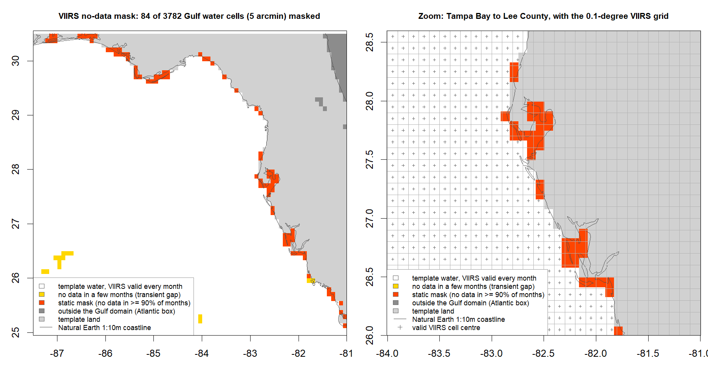
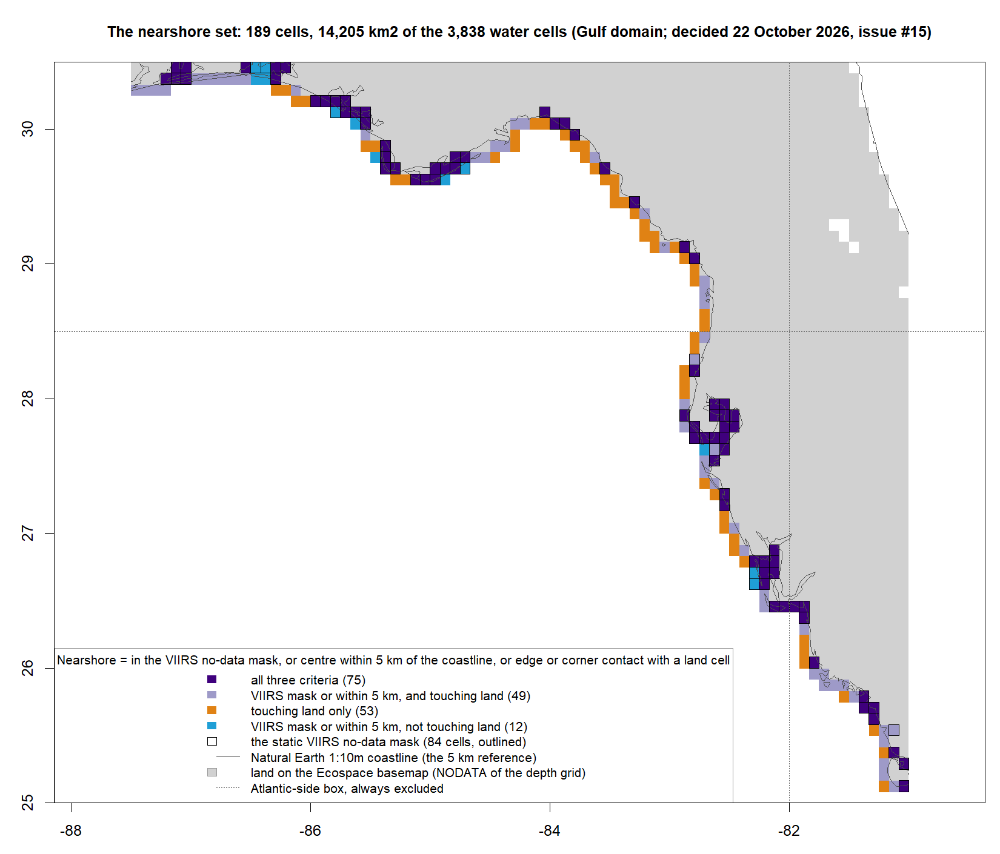
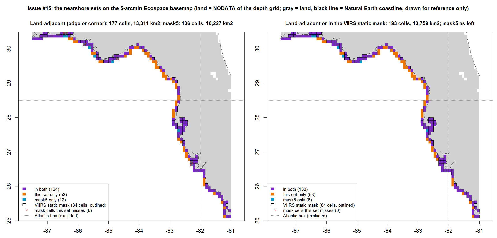
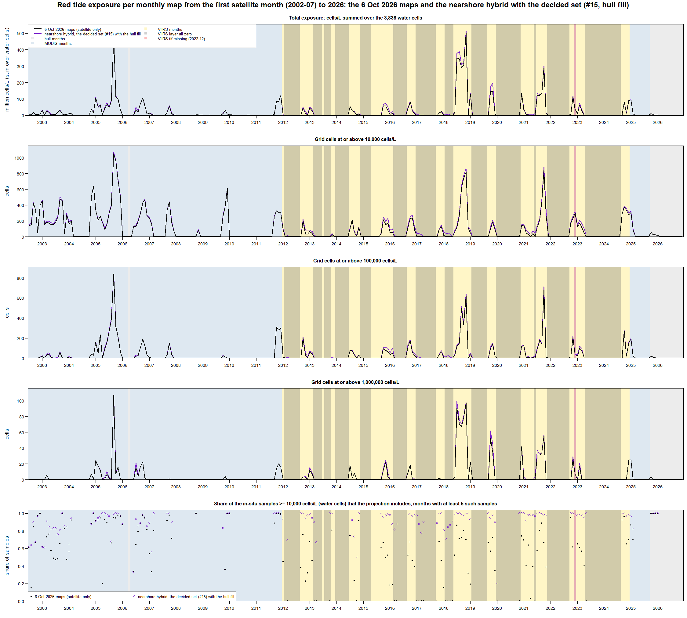

# Issue #5: Are the satellites missing nearshore blooms? 

This markdown provides a summary of [WFS-FEM/RedTideMaps#5](https://github.com/WFS-FEM/RedTideMaps/issues/5). The work done is performed in a series of sub-issues [#6](https://github.com/WFS-FEM/RedTideMaps/issues/6), [#8](https://github.com/WFS-FEM/RedTideMaps/issues/8), [#11](https://github.com/WFS-FEM/RedTideMaps/issues/11), [#10](https://github.com/WFS-FEM/RedTideMaps/issues/10), [#15](https://github.com/WFS-FEM/RedTideMaps/issues/15) and [#18](https://github.com/WFS-FEM/RedTideMaps/issues/18). A related issue is the hull method of [#3](https://github.com/WFS-FEM/RedTideMaps/issues/3).  

In this summary, we first explain the methods and reasoning. The appendix includes the exact numbers, parameters, files, and reproduction steps. Every number comes from a table in one of the issue folders under `docs/`, named where it is used. This document is the overall explainer for the work that updated the red tide maps with the nearshore hybrid approach: the final map products are listed just below, the method is in section 3, the results in section 4, the decisions in section 5, what comes after in section 6, and the evidence by issue in the appendix.

**Where things stand (24 October 2026, issue #18):** The nearshore hybrid rule described below, with the set settled in #15 (the `mask5` set plus the cells that touch a land cell of the Ecospace basemap, 189 cells, hull fill), is in the pipeline as rule `"mask5adj"` and is the default for both satellite eras. The delivered maps (`out/5min/ecospace_ascii/`, and the 15-arcmin set in `out/15min/ecospace_ascii/`) are the hybrid maps: regenerated first with the FWC samples frozen at the 22 September 2026 pull and verified against the #15 prototype month by month, then with the new FWC samples pulled, to 21 October 2026, which changed only September and October 2026, both hull-served months, and copied to the Ecospace ST drivers folder. With both keys at `"none"` the pipeline still reproduces the 6 October 2026 maps byte for byte. A monthly comparison PDF of all 504 months, with the delivered map beside the samples, the unclipped surface and the three clips, was added on 24 October (PR #20). The follow-ups are in section 6.

**The final map products (for now, as of the pipeline run of 2 October 2026):**

- **The maps Ecospace reads, 5 arcmin:** `out/5min/ecospace_ascii/sdmTMB_log__<yyyymm>.asc`, one ASCII grid per month from 1985-01 to 2026-12 (504 files, 66 x 78 cells, cells/L, NODATA on land), built with rule `"mask5adj"` from the FWC samples to 21 October 2026; copied to the Ecospace ST drivers folder `<ecospace_root>/5min/red tide/sdmTMB/`. The MD5 of every file is in `docs/issue18_implement-hybrid-clipping/tables/md5_refresh5_issue18.csv`; the source of every month (VIIRS hybrid, MODIS hybrid or hulls, and whether the hybrid changed it) is in `out/5min/clipped/clipping_source.csv`; the maps as a PDF, twelve months (one year) per page, in `out/5min/plots/sdmTMB_log_stack_198501-202612_clipped_combined.pdf`.
- **The same at 15 arcmin:** `out/15min/ecospace_ascii/` (22 x 26 cells; the nearshore set has 53 cells there), copied to `<ecospace_root>/15min/red tide/sdmTMB/`; MD5 in `tables/md5_refresh15_issue18.csv` of the same folder.
- **The month-by-month view:** `docs/issue18_implement-hybrid-clipping/clip_months_hybrid_issue18.pdf`, one row per month for all 504 months (the FWC samples, the unclipped surface, the VIIRS, MODIS and hull clips, and the delivered map, each map with its total exposure and class counts; the page of a month is its year minus 1984), with the numbers in `tables/clip_class_counts_hybrid_issue18.csv`.
- **The record view:** `docs/issue18_implement-hybrid-clipping/tables/record_months_issue18.csv` (every month, the 6 October 2026 maps against the delivered maps: exposure, cells at the thresholds, samples included), `figures/fig2_record_2002-2026_issue18.png` (the same as a time series; `figures/fig1_record_2002-2026_issue5.png` here is the same figure), `figures/fig1_headline_months_issue18.pdf` (the 16 headline months of #6, before and after).
- **To regenerate them:** `Rscript run_redtide_maps.R` from the repository root with the defaults (the README's "Monthly rerun"); the next run will pull the FWC samples published since 21 October 2026 and change only the hull-served tail months, as the refresh step of #18 did.

## 1. Context

Each monthly red tide map that Ecospace reads is built in two steps: a statistical surface fitted to that month's FWC cell counts (sdmTMB), then a "footprint" that cuts the surface down to where the bloom actually was. The footprint comes from the best available source for the month: the VIIRS satellite product (2012 onward), then MODIS (2002 to 2011, and later months without a VIIRS file), then polygons drawn around the positive samples (the buffered hulls). Inside the footprint, a cell keeps its fitted value; outside it, the cell is zero.

### Overarching Questions

The 6 October 2026 audit of the pipeline (`docs/review/`) found that 89 of the 155 VIIRS months contain no positive cells at all. The code treats any VIIRS file as the footprint, so those months are written as all-zero maps, including 58 months with enough positive samples to fit a surface. For example, in January to March 2017, FWC counted 274, 320, and 258 positive samples, while the delivered maps showed no red tide anywhere on the shelf; FWC bulletins for many of these months reported blooms, fish kills, and respiratory irritation. 

## 2. Work performed (summary of the #5 sub-issues)

#### Issue #6 (8 to 13 October): the evidence.
For every month, the script compared the unclipped surface with the VIIRS-, MODIS-, and hull-clipped maps and the samples. The zeros are in the source files and not an artifact of our processing. 

Of the 58 fitted months written as zero, 16 have a fitted surface that reaches 10,000 cells/L somewhere (the "headline" months). If the hull footprint had been used over those 16 months, it would have retained 59,637 km2 of bloom area. 

The same comparison showed the problem wasn't confined to the zero months: even where VIIRS sees the bloom, 41% of water samples at or above 10,000 cells/L fall outside the VIIRS footprint (17% for MODIS, 0% for the hulls by construction). No rule was decided in #6; it listed five candidate rules and handed the decision to #5. A potential suggestion was to use the buffered hulls where a fitted surface exists and VIIRS is zero, while new VIIRS maps are awaited.

I also queried the FWC bulletins for these months to check reports for all zero months. In many, FWC reported significant blooms, including reports of respiratory irritation and fish kills. A table that compiles these findings, including links to the bulletins, is available in 
[docs/issue6_VIIRS-zeros/FWC-bulletins/FWC_Red_Tide_17_Month_Evidence_Table.md](https://github.com/WFS-FEM/RedTideMaps/blob/main/docs/issue6_VIIRS-zeros/FWC-bulletins/FWC_Red_Tide_17_Month_Evidence_Table.md)

**Exchanges with Yao Yao (14 to 20 October).** Yao explained that in the VIIRS product, white means valid observations with no bloom detected and gray means no valid observations; that is, the nearshore pixels are masked out of the processing because of atmospheric-correction uncertainty and land adjacency, so samples taken close to shore can fall in masked areas; that the VIIRS > MODIS > hulls hierarchy should be kept for continuity; and that where VIIRS has valid observations and detects no bloom, the VIIRS result should stand rather than be replaced by MODIS or hulls. She suggested a split: in-situ data for the nearshore band (2 to 5 km from shore) and satellite data offshore. That suggestion shaped the rule.

#### Issue #8 (19 to 20 October):  diagnosis and a prototype.
Step 1 located every sample relative to the VIIRS product. The product carries a static no-data band along the coast and in the bays, 0 to about 5 km wide: 84 of the 3,782 grid cells of the Gulf domain, 2% of the water, at a median depth of about 2 m. That band holds 61 to 66% of all FWC samples in every abundance class, from background to the highest counts. 

Of the high-count samples VIIRS misses in months where it does see the bloom, 79% are in that band, and most of the rest are within 2 km of the coast in cells that straddle the shoreline. The satellite isn't missing the blooms; rather, it appears that it can't see where most samples are taken. Step 2 prototyped a hybrid on the existing clipped layers for five candidate nearshore sets (the mask alone; within 2, 5 or 10 km of the coast; the mask or within 5 km) and tabulated what each would change. The decision, taken by Holden after a meeting with Yao on 20 October, is in section 3. 

#### Issue #11 (20 to 22 October): the rule in the pipeline.
The rule was implemented behind a configuration switch, with the default left at today's behavior. Two checks: with the switch off, the pipeline reproduced the 6 October maps byte for byte (all 504 monthly files); with it on, exactly the 121 VIIRS months that have a hull inside the nearshore set change, and every one of the 155 VIIRS months matches the #8 prototype on 11 per-month metrics. Then the VIIRS-only and hybrid maps were compared (Section 4).

#### Issue #10 (20 to 22 October): the MODIS months.
The same question applies to the 123 months served by MODIS nFLH polygons. MODIS has no coastal no-data band: 132 of the 136 nearshore cells are MODIS-positive in at least one of those months, and the samples MODIS misses are mostly offshore, where it saw nothing. The same rule was still applied, on Holden's decision, so that the coastal strip is treated the same way in every satellite era rather than changing at 2012 and again at 2025; the change is small in the aggregate, but it brings the coastal samples to the same 99% inclusion as in the VIIRS era. Three verification runs showed the change touches exactly the 87 MODIS months with a nearshore hull and nothing else, and that the switched-off pipeline still reproduces the 6 October maps.

### Issue #15 (22 October): finalizing the nearshore set 
Before the implementation call, an alternative was tested with no pipeline change: call a water cell nearshore when it shares an edge or a corner with a land cell of the Ecospace basemap itself (the same 5-arcmin depth grid the pipeline uses; land is where that grid has no depth), and inside those cells use the raw sdmTMB projection instead of the hull-clipped one. This implemented two changes: changing the "nearshore" set with a different rule and using the raw projection. 

Two findings. First, the set: the land-adjacent cells (177) cover 78 of the 84 cells in the VIIRS no-data band and 124 of the 136 `mask5` cells; they miss two bay cells cut by the northern map edge and nine cells that sit against barrier islands the grid draws as water, and they add 53 cells that touch land but whose centres lie 5 to 12 km from the coastline (a cell is 8 to 9 km wide, so a corner neighbour reaches further than 5 km). *Decision: use a union of the methods: i.e., within the VIIRS mask, within 5 km of the coast, or touching land*. The rule is described immediately below in the methods and written out in full in `docs/issue15_adjacent-land-hybrid/nearshore-set-method.md`.

Second, the fill: on the same set, the raw projection includes the same samples as the hull fill (93.4% of the water samples >= 10,000 cells/L in the satellite months) but adds 2.5 times as much exposure (+17.9% against +8.2%), because it lays the model surface along the whole strip in every fitted month, 57% of it below 10,000 cells/L; the hull fill adds only where positive samples sit. *Decision: do not use the raw fill and continue to use the hull fill.*

**Issue #18, step 6 (24 October, PR #20): the monthly comparison PDF.** The #6 PDF redrawn from the delivered run with a sixth column for the delivered map: for every month from 1985-01 to 2026-12, the FWC samples, the unclipped surface, the VIIRS, MODIS and hull clips (the one the final map is built on framed in red) and the hybrid map, each map panel with its total exposure (cells/L summed over the water cells) and its cell counts by FWC class (`docs/issue18_implement-hybrid-clipping/clip_months_hybrid_issue18.pdf`, 42 pages; the numbers in `tables/clip_class_counts_hybrid_issue18.csv`). The script asserts first that the maps on disk are the delivered ones and that the delivered map is the hybrid of the framed clip and the hulls in every satellite month. Over all 504 months the delivered maps carry 9.42e9 cells/L of exposure against 8.88e9 for the clips they are built on (x 1.062; x 1.084 over the 278 satellite months, as in section 4).

## 3. The method change

**The nearshore set (final definition, 22 October 2026).** A fixed set of grid cells near the coast, where satellite imagery is expected to be affected by land. A water cell of the Gulf domain (the Atlantic-side box east of 82 W and north of 28.5 N is always excluded) is **nearshore** if it meets at least one of three criteria:

1. **Masked by VIIRS:** its 0.1-degree VIIRS cell is in the product's static no-data band (no data in at least 90% of the 155 monthly layers). 84 cells.
2. **Within 5 km of the coast:** its center lies within 5 km of the Natural Earth 1:10m coastline. 132 cells.
3. **Adjacent to land:** it shares an edge or a corner with a land cell of the Ecospace basemap. 177 cells.

Criteria 1 and 2 are the `mask5` set of #8 (136 cells); criterion 3, from #15, adds 53. The set is **189 cells, 14,205 km2, 4.9% of the water cells**, a strip one cell wide along the whole Gulf coast and in the bays, 3.4 m deep at the median and 24 m at most. 

75 cells meet all three criteria, 49 are in the VIIRS band or within 5 km and also touch land, 53 touch land only, and 12 are in the band or within 5 km but touch no land cell (bays cut by the northern map edge, and cells against barrier islands the grid draws as water). 

It is the same set for every month and both sensors; the full statement of the rule, with every parameter and source, is `docs/issue15_adjacent-land-hybrid/nearshore-set-method.md`, and the cells are listed in `docs/issue15_adjacent-land-hybrid/tables/nearshore_set_issue15.csv`.

**The rule.** For a month served by a satellite, the map is built as before and then, inside the nearshore set only, each cell takes the larger of two values: the satellite-clipped map and the hull-clipped map for that month. Outside the set, the satellite result stands, zeros included. 

In other words: for all cells except the nearshore set, we believe the satellites, even when they see nothing. For the one-cell grid band of nearshore cells, where the satellites cannot look and where many in situ samples were taken, we clip red tide blooms with buffered hulls.

**What the hull map is.** The pipeline's own buffered-hull footprint, the fallback already used for months without satellite coverage (fixed in #3): the month's positive samples are grouped so that two samples share a footprint when a chain of positives connects them with every link under 75 km; each group with at least four distinct locations gets a concave hull, smaller groups get the points themselves, and every footprint is buffered by 10 km. Inside the footprint, the fitted surface stands.

**What the rule does and does not do.**

- It adds bloom area only inside the nearshore set, and only where the hull map has something the satellite map does not. It never lowers a cell: a satellite detection is never removed.
- Offshore, a valid satellite zero is a zero. A month in which VIIRS saw nothing anywhere stays all-zero offshore; it gains only the nearshore cells the samples support. The full "use the hull when VIIRS is zero" fallback was considered and dropped.
- Months served by the hulls alone (1985 to 2002-06, and the latest months) are untouched: the hull is already their footprint.
- Samples in bays and estuaries that the Ecospace basemap grid itself marks as land (24% of all FWC samples) are outside every map and are not changed by this rule.

## 4. Results from the rule change

The 6 October 2026 maps against the delivered maps: the hybrid with the decided set (the union of #15) and the hull fill, from the final 5-arcmin pipeline run of #18 (frozen samples), which equals the #15 prototype month by month in all 504 months. `mask5` (#11, #10) is given in brackets where it differs.

| | VIIRS months (155, 2012 to 2024) | MODIS months (123, 2002 to 2011, 2022-12, 2025) | whole record (504 months, 1985 to 2026) |
|---|---|---|---|
| months whose map changes | 121 | 89 | 210 (208) |
| water samples >= 10,000 cells/L that the map includes | 53% -> 97% | 82% -> 90% | 72% -> 96% |
| samples > 1,000,000 cells/L that the map includes | 64% -> 99% | 89% -> 94% | 78.5% -> 98% |
| cell-months at or above 10,000 cells/L | 10,204 -> 12,133, +19% | 17,766 -> 18,341, +3% | 35,606 -> 38,110, +7% |
| total exposure (cells/L summed over all water cells and months) | +11% | +3.5% | +6% |

*Samples included* counts the in-situ water-cell samples whose grid cell is non-zero in the map, the converse of the samples the footprint cuts. 

*Total exposure* is the simple sum of cells/L over the 3,838 water cells, the quantity Ecospace uses; cell-months count grid cells at or above a level, summed over the months.

*Cell months >10,000 cells/L* is a measure of bloom extent integrated over time. For example, a cell that stays at bloom level for four months contributes four; one month with 300 cells at bloom level contributes 300. 

Sources: `docs/issue18_implement-hybrid-clipping/tables/record_groups_issue18.csv` (the `v6oct`, `mask5` and `final` variants, from the delivered maps), which equals `docs/issue15_adjacent-land-hybrid/tables/record_groups_issue15.csv`, `exposure_by_era_issue15.csv`, `examine_groups_issue15.csv` and `mask5_vs_union_issue15.csv` (the `union_hull` and `mask5` variants of the prototype).

Red tide projections for all months are shown in the following PDF, including plots for A) FWC cell samples, 2) the unclipped sdmTMB projections, 3) VIIRS clipping, 4) MODIS clipping, 4) hull clipping, and 5) the final, nearshore hybrid approach that combines satellite imagery and hull clipping for the 189 nearshore cells: **[Red Tide Projections](../issue18_implement-hybrid-clipping/clip_months_hybrid_issue18.pdf)**

### Notes
- **Changes are made during bloom months** the coastal strip and the bays, in every satellite era. In the VIIRS era, *91% of the added exposure falls in the 60 months where VIIRS also saw the bloom offshore*.

- **Changes in the all-zero months** The 58 all-zero VIIRS months gain 358 cell-months at or above 10,000 cells/L and 88.5% of their high-count samples. The 16 headline months go from nothing to a footprint each (2017-01: 3,037 km2 at or above 10,000 cells/L with 113 of its 116 high-count samples inside; 2021-06: 3,568 km2 and 182 of 188; under `mask5` 2,428 and 2,807 km2).

Four of the headline months, whose high counts sit well offshore in cells VIIRS evaluated, stay almost unchanged: the satellite saw nothing there, and the rule leaves it alone.
  
- **The MODIS era moves less** because MODIS already covers the coast: the rule recovers 328 of the 799 high-count samples the MODIS footprint excludes, the ones inside the set, and leaves the rest, offshore, as they are.
  
- **Nothing moves anywhere else:** the 226 hull months are byte-identical, and with both keys at `"none"` the whole run reproduces the 6 October maps byte for byte.

## 5. Decisions taken

| # | Decision | By, when | Where recorded |
|---|---|---|---|
| D1 | The nearshore set is `mask5`: the VIIRS no-data band, or within 5 km of the coastline (extended by D9 on 22 Oct 2026) | Holden, after the meeting with Yao, 20 Oct 2026 | [#8 decision comment](https://github.com/WFS-FEM/RedTideMaps/issues/8#issuecomment-6299110640); `docs/issue8_nearshore-hybrid/issue8-nearshore-plan.md` section 7 |
| D2 | Inside the set the hull map is the pipeline's own: every positive sample, 75 km linkage, 10 km buffer, no count threshold | same | same; hull parameters from #3 (Holden, 29 Sep 2026, `docs/issue_3-hull-polygons/issue3-hull-fix-plan.md` section 6.5) |
| D3 | The rule applies in every VIIRS month, not only the all-zero ones | same | same |
| D4 | Outside the set a valid satellite zero stands; inside it the cell takes the maximum of the satellite and hull maps; the full hull fallback for all-zero months is dropped | same | same |
| D5 | The MODIS-served months get the same set and rule (a MODIS-specific set is a possible follow-up) | Holden, 22 Oct 2026 | [#10 plan comment](https://github.com/WFS-FEM/RedTideMaps/issues/10#issuecomment-6343290966) and the go at checkpoint 1 |
| D6 | The coastline is Natural Earth 1:10m, tracked in `data/coastline/` | 20 Oct 2026 | #8 decision comment |
| D7 | Both switches default to `"none"` until #5 decides; the delivered maps stay at 6 Oct 2026 and the implementation PRs carry code, checks and docs only | Holden, 20 Oct 2026 (#11 planning) | `docs/issue11_nearshore-hybrid-pipeline/README.md`, PR #12 and PR #13 bodies |
| D8 | The in-situ samples are the FWC counts as filtered today (positive = any count above zero); the definition of a positive sample is a separate follow-up | carried from #3 and the audit (M3) | `docs/review/draft-repo-audit-log.md` |
| D9 | The nearshore set is the union of `mask5` and the land-adjacent cells: in the static VIIRS no-data mask, or centre within 5 km of the Natural Earth coastline, or sharing an edge or a corner with a land cell of the Ecospace basemap (189 cells, 14,205 km2; Gulf domain, the Atlantic cells always excluded). The fill stays the hull (D2, D4); the raw sdmTMB fill tested in #15 was not adopted | Holden, 22 Oct 2026 | #15 thread; `docs/issue15_adjacent-land-hybrid/nearshore-set-method.md` |
| D10 | The hybrid maps with the decided set are the deliverables: rule `"mask5adj"` is the default for both sensors (D7 ends); #5 closes with #18 | Holden, 23 Oct 2026 (#18 planning) | `docs/issue18_implement-hybrid-clipping/issue18-implement-hybrid-plan.md`; PR #19 |
| D11 | The deliverables are regenerated twice: first with the FWC samples frozen at the 22 September 2026 pull (the committed maps equal the verified run byte for byte and the #15 prototype month by month), then with the new FWC samples pulled | same | same |
| D12 | The final runs copy the ASCII files to the Ecospace ST drivers folder (`export_ecospace = TRUE`) | same | same |
| D13 | The 15-arcmin deliverables are regenerated as well (they dated from 22 May 2026, before the hull fix of #3) | same | same |

## 6. The call, what was done, and what comes after

**The call in #5** was one decision for both sensors: accept the hybrid maps with the decided set, or keep the satellite-only maps. Holden took it on 23 October 2026 (D10): the hybrid maps are the deliverables. Before the call, [#15](https://github.com/WFS-FEM/RedTideMaps/issues/15) (22 Oct 2026) examined an alternative rule, a nearshore set read off the Ecospace basemap (water cells touching a land cell) filled with the unclipped sdmTMB projection: `docs/issue15_adjacent-land-hybrid/README.md` compares it with `mask5` on the same metrics. Holden kept the hull fill after seeing the results (the raw fill adds a model strip in every fitted month) and chose the set on 22 October 2026 (D9): the union of `mask5` and the land-adjacent cells (189 cells), which covers the VIIRS mask, the 5 km band and the cells touching land by construction and includes 94.2% of the samples >= 10k cells/L against 93.0%; the rule is written out in `docs/issue15_adjacent-land-hybrid/nearshore-set-method.md`. The implementation, the final decisions and the regenerated projections followed in #18 (below).

**Done in #18 (23 October 2026):** the decided set implemented as `"mask5adj"` and made the default for both sensors; the deliverables regenerated at 5 and 15 arcmin, first with the frozen samples and then with the new FWC samples (D11), committed and copied to the Ecospace ST drivers (D12, D13); the README and this summary updated; #5 closed by PR #19 with the closing record posted on the issue. On 24 October (step 6, PR #20) the monthly comparison PDF of all 504 months was added, with the delivered map beside the samples, the unclipped surface and the three clips and the total exposure printed in every map panel; the final map products are listed at the top of this document.

**Follow-ups noted on the way, not needed for the call:**

- A MODIS-specific nearshore set, since the two satellite products differ in resolution (#10).
- The definition of a positive sample for the hulls (counts at or below 1,000 cells/L are "background" for FWC); the audit's item M3, promised as a follow-up in #3.
- A "check clustering" to-do left in #3 after it closed (12 Oct), unanswered.
- New VIIRS maps from USF, if they come; the rule needs no change for them, since the set is read from the product itself.

## Appendix: the technical record

**How it is switched on.** Two configuration keys in `run_redtide_maps.R`, one per sensor: `cfg$viirs_nearshore` and `cfg$modis_nearshore`, each `"mask5adj"` (the default since #18: all three criteria), `"mask5"` (criteria 1 and 2, implemented in #11 and #10) or `"none"` (the satellite-only maps delivered before #18). The run log names the rule, the size of the set, and the months the rule changed; `clipping_source.csv` records, for every month, which source served it and whether the hybrid changed it.

### A1. The rule as implemented

For a satellite month `m` with satellite-clipped layer `S_m` (VIIRS or MODIS, NA set to 0 on water) and hull-clipped layer `H_m`, and the nearshore set `N` (a fixed cell set):

    hybrid_m[c] = max(S_m[c], H_m[c])   if c in N
    hybrid_m[c] = S_m[c]                 otherwise

`N`, the decided set (`"mask5adj"`, #15): a template water cell outside the Atlantic-side box (east of 82 W and north of 28.5 N, which VIIRS does not cover) is in `N` if (1) its 0.1-degree VIIRS cell is NA in at least 90% of the 155 VIIRS layers (`mask_share = 0.9`), or (2) its centre lies within 5 km of the Natural Earth 1:10m coastline (nearest vertex of the line densified to 200 m, UTM 17N; `coast_km = 5`, `coast_step_m = 200`), or (3) any of its eight neighbours is a land cell of the basemap, i.e. NODATA of the depth grid (`raster::adjacent(directions = 8)`; the grid borders are not land). On the 5-arcmin template: 84, 132 and 177 cells by criterion; 189 cells, 14,205 km2 in all (75 meet all three, 49 meet 1 or 2 and 3, 53 meet 3 only, 12 meet 1 or 2 only); median depth 3.4 m, maximum 24 m (`docs/issue15_adjacent-land-hybrid/tables/nearshore_set_issue15.csv`, `set_coverage_issue15.csv`). Criteria 1 and 2 alone are `mask5` as implemented today: 136 cells, 10,227 km2, 80 cells in both; its 84 mask cells have a median depth of about 2 m and their centres sit a median 1.8 km from the coastline (the 0.1-degree cell centres of the band, a median 1.0 km), the whole `mask5` set a median 2.1 km (`docs/issue8_nearshore-hybrid/tables/hybrid_sets_issue8.csv`); the 53 cells criterion 3 adds have their centres 5.0 to 12.1 km from the coastline (median 6.6).

The cascade per month is hybrid > VIIRS > hybrid_modis > MODIS > hull, where the hybrid stacks exist only for the months and sensors whose switch is on. The MODIS hybrid is built for the MODIS months that have no VIIRS layer only.

### A2. Code, configuration, outputs

| What | Where |
|---|---|
| nearshore set | `fn.nearshore_mask()` in `scripts/process_hybrid.R` (in `scripts/process_VIIRS.R` until #10); rules `"mask5"` (#11) and `"mask5adj"` (criterion 3 added, #18; prototyped by `docs/issue15_adjacent-land-hybrid/check_adjacent_hybrid_issue15.R`), writes `out/<res>min/clipped/nearshore_mask_<rule>.grd` |
| hybrid clip | `fn.clip_2_hybrid(file_sat_clipped, file_hull_clipped, file_mask, file_depth, dir_out, source = "viirs" / "modis", months = NULL)` in `scripts/process_hybrid.R`; writes `*_clipped_hybrid.grd` (VIIRS) and `*_clipped_hybrid_modis.grd` (MODIS) |
| cascade and ASCII | `make_redtide_ascii(file_hull, file_viirs, file_modis, file_hybrid, file_hybrid_modis, ...)` in `scripts/polygon_clipping_rt.R`; `clipping_source.csv` columns `pred, viirs, modis, hybrid, hybrid_modis, hybrid_changed, use` |
| hulls | `fn.buffered_hulls()` and `fn.clip_2_hulls()` in `scripts/polygon_clipping_rt.R`; `hull_link_km = 75`, `hull_buffer_km = 10`, `hull_min_pts = 4`, `hull_concavity = 2`, `hull_warn_span_km = 300`; diagnostics in `out/<res>min/sdm/hull_diagnostics.csv` |
| configuration | `cfg$viirs_nearshore`, `cfg$modis_nearshore` (`"mask5adj"` default since #18, `"mask5"`, `"none"`), validated after `config.local.R`; `cfg$fwc_refresh = FALSE` reuses the local FWC CSV for reproducibility runs; `cfg$export_ecospace = TRUE` copies the drop to the Ecospace ST drivers; documented in `config.local.example.R` and the README configuration table |
| coastline | `data/coastline/ne_10m_coastline_wfs.gpkg` (`paths$file_coast`), README beside it |
| run log | lines `Nearshore rule mask5: 136 cells, 10,227 km2 ...`, `Hybrid: 121 of 155 VIIRS months changed ...`, `Hybrid (MODIS): 87 of 123 MODIS-served months changed ...` |

### A3. Verification chain

| Run | Switches | Result | Check |
|---|---|---|---|
| 6 Oct 2026 baseline | none | the delivered maps; MD5 of the 504 ASCII files in `docs/issue11_nearshore-hybrid-pipeline/tables/md5_baseline_issue11.csv` | |
| #11 "none" | VIIRS none | 0 of 504 files differ from the baseline | `check_hybrid_issue11.R`, stage `none` |
| #11 "mask5" | VIIRS mask5 | 121 files differ, all VIIRS months with a nearshore hull; equals the #8 prototype in all 155 months on 11 metrics | stage `mask5` |
| #10 run A | VIIRS mask5, MODIS none | 0 of 504 files differ from the #11 mask5 run (the refactor and the cascade change alter nothing) | `check_modis_hybrid_issue10.R`, stage `regress` |
| #10 run B | both mask5 | 87 files differ from run A, all MODIS months with a nearshore hull; equals the #10 examine prototype in all 123 months on 11 metrics; VIIRS hybrid and hull months byte-identical | stage `mask5` |
| #10 run 0 | both none | 0 of 504 files differ from the baseline | the #11 stage `none`, unchanged |
| #15 examine | no run; prototype on the on-disk stacks and the #10 and #11 run copies | the decided set changes 210 months (121 VIIRS, 89 MODIS); the per-month `union_hull` columns of `examine_months_issue15.csv` are what the `"mask5adj"` run must match month by month, and the set itself is `nearshore_set_issue15.csv` | `check_adjacent_hybrid_issue15.R`, stage `examine` (36 assertion blocks) |
| #18 run A | both `mask5adj` (local override, defaults still none) | 210 files differ from the baseline, exactly the `hybrid_changed` months; the set raster = the #15 table cell for cell; all 278 satellite months equal the prototype on 9 metrics; hull months byte-identical | `check_final_hybrid_issue18.R`, stage `rule` |
| #18 run 0 | both none (after the code change) | 0 of 504 files differ from the baseline | the #11 stage `none`, unchanged |
| #18 final 5 | the defaults (`mask5adj`), frozen samples, export on | 0 of 504 files differ from run A; the Ecospace ST drivers copy equals `ecospace_ascii/`; the record metrics equal the #15 prototype in all 504 months | stages `final` and `record` |
| #18 final 15 | the same at 15 arcmin | set 53 cells, 35,890 km2 (13 in the VIIRS mask, 20 within 5 km, 48 touching land); 205 months changed (118 VIIRS, 87 MODIS); the hybrid relations hold; 323 of 504 files differ from the tracked May 2026 files; the Ecospace copy equals `ecospace_ascii/` | stage `final`, `RT_QA_RES=15` |
| #18 refresh | the defaults, the FWC samples to 21 Oct 2026, both resolutions | 2 of 504 files changed at each resolution (2026-09 and 2026-10, hull-served); the satellite months byte-identical to the frozen runs; the Ecospace copies equal `ecospace_ascii/` | stage `refresh` |

Every check script reads only what the last pipeline run left on disk and the tracked tables, uses no random numbers, asserts the numbers it reports, and writes byte-identical CSVs and PNGs on rerun. Each run takes 7 to 15 minutes alone on the machine; the FWC samples were frozen at 22 September 2026 for all of them. The figure in section 4 is drawn from the #15 per-month table by `plot_summary_issue5.R` in this folder (no computation, byte-identical on rerun).

### A4. The numbers

**VIIRS era, 155 months (`groups_issue11.csv`, `exposure_groups_issue11.csv`):** bloom area >= 10,000 cells/L 776,173 -> 898,477 km2 (x 1.16); >= 100,000 cells/L 427,929 -> 475,626 km2; months with any bloom area 58 -> 75; samples >= 10,000 cells/L inside 4,655 -> 8,316 of 8,745 (53.2% -> 95.1%); high samples 744 -> 1,150 of 1,168 (63.7% -> 98.5%); exposure 4.12e9 -> 4.54e9 (+10.2%); cell-months >= 10k / 100k / 1M cells/L 10,204 -> 11,818 / 5,633 -> 6,262 / 901 -> 973. The 58 zeroed months: 0 -> 21,750 km2, samples inside 0 -> 773 of 904 (85.5%), exposure 0 -> 3.05e7 (7% of the VIIRS-era addition).

**MODIS era, 123 months (`examine_groups_issue10.csv`):** 87 months change; bloom area 1,343,000 -> 1,371,529 km2 (+2.1%); samples >= 10,000 cells/L inside 3,736 -> 4,035 of 4,535 (82.4% -> 89.0%); high 393 -> 413 of 442; exposure 2.375e9 -> 2.429e9 (+2.3%); within 5 km of the coast the share included goes 87.8% -> 98.9%, beyond 5 km 75.4% -> 76.1%; the 29 all-zero MODIS maps stay all-zero.

**Whole record, 504 months, `mask5` (`record_groups_issue10.csv`; 6 Oct -> VIIRS rule -> both rules):** exposure 8.87e9 -> 9.29e9 -> 9.35e9 (+4.7%, +5.3%); samples >= 10,000 cells/L inside 12,861 -> 16,522 -> 16,821 of 17,760 (72.4% -> 93.0% -> 94.7%); high samples 78.5% -> 96.9% -> 97.9% of 2,195; cell-months >= 10k / 100k / 1M 35,606 -> 37,220 -> 37,598 / 13,290 -> 13,919 -> 14,018 / 1,716 -> 1,788 -> 1,799. The 226 hull months: 2.38e9 exposure, 99.8% of their samples inside, unchanged.

**The decided set, the union of `mask5` and the land-adjacent cells with the hull fill (#15; `mask5_vs_union_issue15.csv`, `exposure_by_era_issue15.csv`, `examine_groups_issue15.csv`, `record_groups_issue15.csv`):** over the 278 satellite months, exposure 6.49e9 -> 7.04e9 (+8.4%; `mask5` +7.3%), cell-months >= 10k / 100k / 1M 27,970 -> 30,474 / 10,569 -> 11,462 / 1,253 -> 1,346, samples >= 10,000 cells/L inside 8,391 -> 12,515 of 13,280 (63.2% -> 94.2%; `mask5` 93.0%), high samples 1,137 -> 1,573 of 1,610 (70.6% -> 97.7%), 210 months changed (121 VIIRS, 89 MODIS). By era: VIIRS 4.12e9 -> 4.58e9 (+11.3%), samples 53.2% -> 96.6%, high 63.7% -> 99.2%, cell-months >= 10k 10,204 -> 12,133; MODIS 2.37e9 -> 2.46e9 (+3.5%), samples 82.4% -> 89.6%, high 88.9% -> 93.7%, cell-months >= 10k 17,766 -> 18,341. The 58 zeroed months: exposure 0 -> 4.37e7, 358 cell-months >= 10k, samples 800 of 904 (88.5%), high 31 of 32; the 16 headline months 768 of 867 samples (88.6%). Whole record: exposure 8.87e9 -> 9.42e9 (+6.2%), samples 12,861 -> 16,985 of 17,760 (72.4% -> 95.6%), high 1,722 -> 2,158 of 2,195 (78.5% -> 98.3%), cell-months >= 10k / 100k / 1M 35,606 -> 38,110 / 13,290 -> 14,183 / 1,716 -> 1,809. The difference from `mask5` is 164 samples and 7.4e7 cells/L summed (4.5e7 in the VIIRS months, 2.9e7 in the MODIS months), all from the 53 land-adjacent cells. The raw sdmTMB fill tested and not adopted: +17.9% exposure over the satellite months on the land-adjacent set, the same samples included.

**The prototype choice (#8, `hybrid_groups_issue8.csv`), samples >= 10,000 cells/L inside over the 155 VIIRS months / bloom area added in VIIRS-valid cells:** current 53% / 0; mask 88% / 227 km2; coast2 80% / 13,026; coast5 91% / 32,143; mask5 95% / 32,143; coast10 98% / 71,649; hull alone 100% but it would drop 438,288 km2 of the VIIRS footprint, which is why it is a reference and not a candidate.

### A5. Evidence by issue

| Issue, PR | Folder | Script | Key tables and figures |
|---|---|---|---|
| #3, PR #4 (30 Sep 2026) | `docs/issue_3-hull-polygons/` | `scripts/qa/check_hulls_issue3.R` | `issue3-hull-fix-plan.md` (root cause, sensitivity at 50 / 75 / 100 km, decisions), `issue3_hull_before_after.png` |
| #6, PR #7 (13 Oct 2026) | `docs/issue6_VIIRS-zeros/` | `scripts/qa/check_clipping_issue6.R` | `tables/clip_comparison_issue6.csv` (one row per month), `clip_months_issue6.pdf`, `figures/fig4_headline_months.png`, `FWC-bulletins/FWC_Red_Tide_17_Month_Evidence_Table.md` |
| #8, PR #9 (20 Oct 2026) | `docs/issue8_nearshore-hybrid/` | `check_nearshore_issue8.R`, `hybrid_nearshore_issue8.R` | `tables/t1` to `t5` (samples by VIIRS cell status and distance), `tables/hybrid_sets_issue8.csv`, `tables/hybrid_groups_issue8.csv`, `figures/fig1`, `fig5`, `fig6_hybrid_headline.pdf`, `hybrid_months_issue8.pdf`, `comments/hybrid_summary.md` |
| #11, PR #12 (22 Oct 2026) | `docs/issue11_nearshore-hybrid-pipeline/` | `check_hybrid_issue11.R` | `tables/md5_*`, `tables/hybrid_vs_prototype_issue11.csv`, `tables/groups_issue11.csv`, `tables/exposure_*_issue11.csv`, `figures/fig1` to `fig6`, `comments/compare_summary.md`, `comments/exposure_summary.md` |
| #10, PR #13 (22 Oct 2026) | `docs/issue10_modis-nearshore-hybrid/` | `check_modis_hybrid_issue10.R` | `tables/examine_*_issue10.csv`, `tables/excluded_*_issue10.csv`, `tables/md5_run{A,B}_issue10.csv`, `tables/hybrid_modis_vs_prototype_issue10.csv`, `tables/record_*_issue10.csv`, `figures/fig1` to `fig5`, `comments/examine_summary.md`, `comments/compare_summary.md` |
| #15, PR #16 (22 Oct 2026) | `docs/issue15_adjacent-land-hybrid/` | `check_adjacent_hybrid_issue15.R` | `nearshore-set-method.md` (the rule in full), `tables/nearshore_set_issue15.csv` (the 189 cells), `tables/set_coverage_issue15.csv`, `tables/mask5_vs_union_issue15.csv`, `tables/exposure_by_era_issue15.csv`, `tables/examine_*_issue15.csv`, `tables/record_*_issue15.csv`, `tables/fill_values_issue15.csv`, `figures/fig1_sets`, `fig2_record`, `fig3_months.pdf`, `fig4_cells`, `fig5_nearshore_set`, `comments/examine_summary.md` |
| #18, PR #19 (23 Oct 2026), PR #20 (24 Oct 2026) | `docs/issue18_implement-hybrid-clipping/` | `check_final_hybrid_issue18.R`, `clip_months_hybrid_issue18.R` | `issue18-implement-hybrid-plan.md` (the decisions D10 to D13), `tables/md5_runA_issue18.csv`, `tables/hybrid_vs_prototype_issue18.csv`, `tables/nearshore_set5_issue18.csv`, `tables/md5_final5_issue18.csv`, `tables/md5_final15_issue18.csv`, `tables/record_*_issue18.csv`, `tables/md5_refresh*_issue18.csv`, `figures/fig1_headline_months_issue18.pdf`, `figures/fig2_record_2002-2026_issue18.png`, `comments/record_summary.md`; step 6: `clip_months_hybrid_issue18.pdf` (all 504 months, the delivered map beside the samples and the clips, with the exposure of every map), `tables/clip_class_counts_hybrid_issue18.csv`, `figures/fig3_monthly_rows_example_issue18.png` |
| #5, PR #14, PR #17 and PR #19 | `docs/issue5_nearshore-hybrid-summary/` | `plot_summary_issue5.R` | this document; `figures/fig1_record_2002-2026_issue5.png` |

### A6. Timeline

| Date (2026) | Event |
|---|---|
| 24 to 30 Sep | #1 fresh-clone run and fixes (PR #2, PR #4) |
| 29 to 30 Sep | #3: spurious coast-wide hull polygons traced to k-means clustering; single-linkage hulls with 75 km linkage decided (Holden) and merged (PR #4) |
| 6 Oct | review-only audit (`docs/review/`); item M1 becomes #5; the 6 Oct deliverables are the baseline of every later check |
| 8 Oct | #5 opened; #6 opened |
| 12 Oct | Dave: use the buffered hulls where a fitted surface exists and VIIRS is zero, while new VIIRS maps are awaited; Chuanmin Hu and Yao Yao contacted |
| 13 Oct | #6 closed, PR #7 merged |
| 14 and 16 to 19 Oct | Yao's replies: valid zeros vs no data, the nearshore mask, keep the hierarchy, the 2 to 5 km split |
| 19 to 20 Oct | #8: diagnosis and prototype; meeting with Yao; decision `mask5`; PR #9 merged |
| 20 to 22 Oct | #11: the rule in the pipeline, verified; PR #12 merged 22 Oct |
| 20 to 22 Oct | #10: the MODIS months examined and the rule applied; PR #13 merged 22 Oct |
| 22 Oct | this summary written (PR #14 merged) |
| 22 Oct | #15: the land-adjacent set and the raw sdmTMB fill tested against `mask5`; the hull fill kept and the set decided as the union (D9); PR #16 merged |
| 22 Oct | this summary updated for #15 (PR #17 merged 23 Oct) |
| 23 Oct | #18: rule `"mask5adj"` in the pipeline, verified (run A = the prototype, run 0 = 6 Oct); the defaults flipped; the deliverables regenerated at 5 and 15 arcmin with the frozen samples, then with the new FWC samples; exported to Ecospace; #5 closed by PR #19 |
| 24 Oct | #18 step 6: the monthly comparison PDF of all 504 months with the delivered hybrid map as a sixth column and the total exposure in every map panel (PR #20); this summary points to the final map products |
