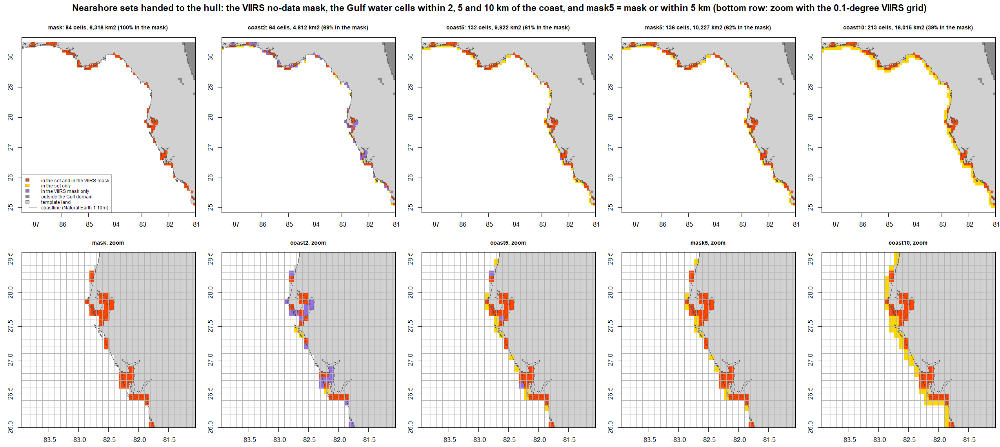
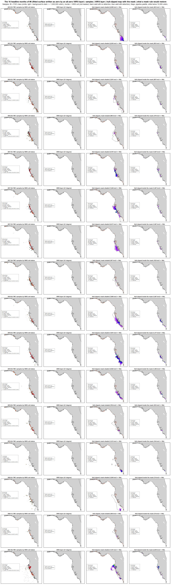
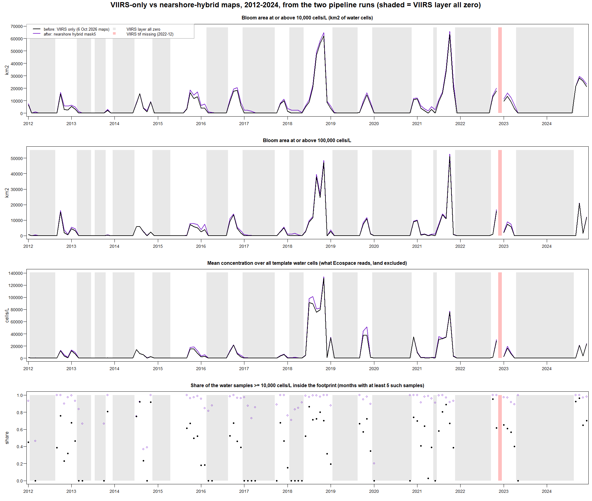
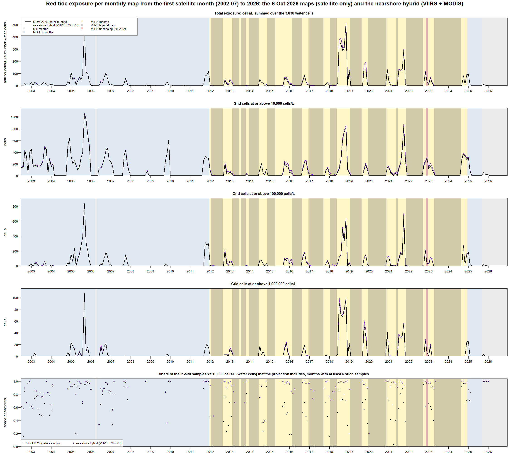

# Issue #5: are the satellites missing nearshore blooms? 

A summary of [WFS-FEM/RedTideMaps#5](https://github.com/WFS-FEM/RedTideMaps/issues/5) and its sub-issues [#6](https://github.com/WFS-FEM/RedTideMaps/issues/6), [#8](https://github.com/WFS-FEM/RedTideMaps/issues/8), [#11](https://github.com/WFS-FEM/RedTideMaps/issues/11) and [#10](https://github.com/WFS-FEM/RedTideMaps/issues/10), with the hull method of [#3](https://github.com/WFS-FEM/RedTideMaps/issues/3) that they rest on, written on 22 October 2026. The first part explains the methods and reasoning; the appendix at the end has the exact numbers, parameters, files and reproduction steps. Every number comes from a table in one of the issue folders under `docs/`, named where it is used.

**Where things stand:** the pipeline on `main` can apply the nearshore hybrid rule described below to both satellite eras, but it is switched off by default, so the delivered maps (`out/5min/ecospace_ascii/`) are still the ones of 6 October 2026. One decision is pending in #5: switch the rule on for both sensors and regenerate the maps, or keep the satellite-only maps.

## 1. Context

Each monthly red tide map that Ecospace reads is built in two steps: a statistical surface fitted to that month's FWC cell counts (sdmTMB), then a "footprint" that cuts the surface down to where the bloom actually was. The footprint comes from the best source available for the month: the VIIRS satellite product (2012 onward), else MODIS (2002 to 2011, and later months without a VIIRS file), else polygons drawn around the positive samples themselves (the buffered hulls). Inside the footprint a cell keeps its fitted value; outside it the cell is zero.

### The questions

The 6 October 2026 audit of the pipeline (`docs/review/`) found that in 89 of the 155 VIIRS months the satellite file contains no positive cell at all. The code treats any VIIRS file as the footprint, so those months are written as all-zero maps, including 58 months with enough positive samples to fit a surface. In January to March 2017, FWC counted 274, 320, and 258 positive samples, while the delivered maps showed no red tide anywhere on the shelf; FWC bulletins for many of these months reported blooms, fish kills, and respiratory irritation. 

Work documented in the sub-issues of #5 examined whether the satellites miss blooms the boats see and, if so, what the maps should do about it.

## 2. What we learned, step by step

**Issue #6 (8 to 13 October): the evidence.** For every month, the script compared the unclipped surface with the VIIRS-, MODIS-, and hull-clipped maps and the samples. The zeros are in the source files and not an artifact of our processing. 

Of the 58 fitted months written as zero, 16 have a fitted surface that reaches 10,000 cells/L somewhere (the "headline" months). If the hull footprint had been used over those 16 months, it would have retained 59,637 km2 of bloom area. 

The same comparison showed the problem wasn't confined to the zero months: even where VIIRS sees the bloom, 41% of water samples at or above 10,000 cells/L fall outside the VIIRS footprint (17% for MODIS, 0% for the hulls by construction). No rule was decided in #6; it listed five candidate rules and handed the decision to #5. A potential suggestion was to use the buffered hulls where a fitted surface exists and VIIRS is zero, while new VIIRS maps are awaited.

**Exchanges with Yao Yao (14 to 20 October).** Yao explained that in the VIIRS product, white means valid observations with no bloom detected and gray means no valid observations; that is, the nearshore pixels are masked out of the processing because of atmospheric-correction uncertainty and land adjacency, so samples taken close to shore can fall in masked areas; that the VIIRS > MODIS > hulls hierarchy should be kept for continuity; and that where VIIRS has valid observations and detects no bloom, the VIIRS result should stand rather than be replaced by MODIS or hulls. She suggested a split: in-situ data for the nearshore band (2 to 5 km from shore) and satellite data offshore. That suggestion shaped the rule.

**Issue #8 (19 to 20 October):  diagnosis and a prototype.** Step 1 located every sample relative to the VIIRS product. The product carries a static no-data band along the coast and in the bays, 0 to about 5 km wide: 84 of the 3,782 grid cells of the Gulf domain, 2% of the water, at a median depth of about 2 m. That band holds 61 to 66% of all FWC samples in every abundance class, from background to the highest counts. 

Of the high-count samples VIIRS misses in months where it does see the bloom, 79% are in that band, and most of the rest are within 2 km of the coast in cells that straddle the shoreline. The satellite isn't missing the blooms; rather, it appears that it can't see where most samples are taken. Step 2 prototyped a hybrid on the existing clipped layers for five candidate nearshore sets (the mask alone; within 2, 5 or 10 km of the coast; the mask or within 5 km) and tabulated what each would change. The decision, taken by Holden after a meeting with Yao on 20 October, is in section 3.

**Issue #11 (20 to 22 October): the rule in the pipeline.** The rule was implemented behind a configuration switch, with the default left at today's behavior. Two checks: with the switch off, the pipeline reproduced the 6 October maps byte for byte (all 504 monthly files); with it on, exactly the 121 VIIRS months that have a hull inside the nearshore set change, and every one of the 155 VIIRS months matches the #8 prototype on 11 per-month metrics. Then the VIIRS-only and hybrid maps were compared (Section 4).

**Issue #10 (20 to 22 October): the MODIS months.** The same question for the 123 months served from MODIS nFLH polygons. MODIS has no coastal no-data band: 132 of the 136 nearshore cells are MODIS-positive in at least one of those months, and the samples MODIS misses are mostly offshore, where it saw nothing. The same rule was still applied, on Holden's decision, so that the coastal strip is treated the same way in every satellite era rather than changing at 2012 and again at 2025; the change is small in the aggregate, but it brings the coastal samples to the same 99% inclusion as in the VIIRS era. Three verification runs showed the change touches exactly the 87 MODIS months with a nearshore hull and nothing else, and that the switched-off pipeline still reproduces the 6 October maps.

## 3. The method change

**The nearshore set.** A fixed set of grid cells where the satellites cannot be trusted: a water cell of the Gulf domain is in the set if its VIIRS cell is in the product's static no-data band, or if the cell center lies within 5 km of the coastline (Natural Earth 1:10m). On the 5-arcmin grid that is 136 cells, 10,227 km2, about 3% of the water cells, in a strip along the coast and in the bays. It is the same set for every month and both sensors. It was named `mask5` in #8 (the VIIRS mask, or within 5 km).

**The rule.** For a month served by a satellite, the map is built as before and then, inside the nearshore set only, each cell takes the larger of two values: the satellite-clipped map and the hull-clipped map for that month. Outside the set, the satellite result stands, zeros included. In words: where the satellite looks, we believe it, even when it sees nothing; where it cannot look, we add what the samples show.

**What the hull map is.** The pipeline's own buffered-hull footprint, the fallback already used for months without satellite coverage (fixed in #3): the month's positive samples are grouped so that two samples share a footprint when a chain of positives connects them with every link under 75 km; each group with at least four distinct locations gets a concave hull, smaller groups get the points themselves, and every footprint is buffered by 10 km. Inside the footprint the fitted surface stands.

**What the rule does and does not do.**

- It adds bloom area only inside the nearshore set, and only where the hull map has something the satellite map does not. It never lowers a cell: a satellite detection is never removed.
- Offshore, a valid satellite zero is a zero. A month in which VIIRS saw nothing anywhere stays all-zero offshore; it gains only the nearshore cells the samples support. The full "use the hull when VIIRS is zero" fallback was considered and dropped, because the nearshore rule covers what it was for while keeping Yao's condition.
- Months served by the hulls alone (1985 to 2002-06, and the latest months) are untouched: the hull is already their footprint.
- Samples in bays and estuaries that the Ecospace grid itself marks as land (24% of all FWC samples) are outside every map and are not changed by this rule.

**How it is switched on.** Two configuration keys in `run_redtide_maps.R`, one per sensor: `cfg$viirs_nearshore` and `cfg$modis_nearshore`, each `"none"` (default, today's maps) or `"mask5"`. The run log names the rule, the size of the set and the months the rule changed; `clipping_source.csv` records, for every month, which source served it and whether the hybrid changed it.

## 4. What changes in the maps

| | VIIRS months (155, 2012 to 2024) | MODIS months (123, 2002 to 2011, 2022-12, 2025) | whole record (504 months, 1985 to 2026) |
|---|---|---|---|
| months whose map changes | 121 | 87 | 208 |
| water samples >= 10,000 cells/L that the map includes | 53% -> 95% | 82% -> 89% | 72% -> 95% |
| samples > 1,000,000 cells/L that the map includes | 64% -> 98.5% | 89% -> 93% | 78.5% -> 98% |
| bloom area (>= 10,000 cells/L, km2 summed over the months) | +16% | +2% | |
| total exposure (cells/L summed over all water cells and months) | +10% | +2% | +5% |

Sources: `docs/issue11_nearshore-hybrid-pipeline/tables/groups_issue11.csv` and `exposure_groups_issue11.csv`; `docs/issue10_modis-nearshore-hybrid/tables/examine_groups_issue10.csv` and `record_groups_issue10.csv`. "Samples included" counts the in-situ water-cell samples whose grid cell is non-zero in the map, the converse of the samples the footprint cuts. "Exposure" is the plain sum of cells/L over the 3,838 water cells, the quantity Ecospace works from.

- **Where the change is:** the coastal strip and the bays, in every satellite era. In the VIIRS era 93% of the added exposure falls in months where VIIRS also saw the bloom offshore; the 58 all-zero VIIRS months gain 21,750 km2 of bloom area in total, and the 16 headline months go from nothing to 147 to 2,807 km2 each (2017-01: 2,428 km2 with 113 of its 116 high-count samples now inside; 2021-06: 2,807 km2 and 171 of 188). Four of the headline months, whose high counts sit well offshore in cells VIIRS evaluated, stay almost unchanged: there the satellite looked and saw nothing, and the rule leaves that alone.
- **The MODIS era moves less** because MODIS already covers the coast; the rule recovers 299 of the 301 excluded high-count samples that lie in the set and leaves the 500 offshore ones (median 25 km from the coast) as they are.
- **Nothing moves anywhere else:** the hull months are byte-identical, and with both keys at `"none"` the whole run reproduces the 6 October maps byte for byte.

## 5. Decisions taken

| # | Decision | By, when | Where recorded |
|---|---|---|---|
| D1 | The nearshore set is `mask5`: the VIIRS no-data band, or within 5 km of the coastline | Holden, after the meeting with Yao, 20 Oct 2026 | [#8 decision comment](https://github.com/WFS-FEM/RedTideMaps/issues/8#issuecomment-6299110640); `docs/issue8_nearshore-hybrid/issue8-nearshore-plan.md` section 7 |
| D2 | Inside the set the hull map is the pipeline's own: every positive sample, 75 km linkage, 10 km buffer, no count threshold | same | same; hull parameters from #3 (Holden, 29 Sep 2026, `docs/issue_3-hull-polygons/issue3-hull-fix-plan.md` section 6.5) |
| D3 | The rule applies in every VIIRS month, not only the all-zero ones | same | same |
| D4 | Outside the set a valid satellite zero stands; inside it the cell takes the maximum of the satellite and hull maps; the full hull fallback for all-zero months is dropped | same | same |
| D5 | The MODIS-served months get the same set and rule (a MODIS-specific set is a possible follow-up) | Holden, 22 Oct 2026 | [#10 plan comment](https://github.com/WFS-FEM/RedTideMaps/issues/10#issuecomment-6343290966) and the go at checkpoint 1 |
| D6 | The coastline is Natural Earth 1:10m, tracked in `data/coastline/` | 20 Oct 2026 | #8 decision comment |
| D7 | Both switches default to `"none"` until #5 decides; the delivered maps stay at 6 Oct 2026 and the implementation PRs carry code, checks and docs only | Holden, 20 Oct 2026 (#11 planning) | `docs/issue11_nearshore-hybrid-pipeline/README.md`, PR #12 and PR #13 bodies |
| D8 | The in-situ samples are the FWC counts as filtered today (positive = any count above zero); the definition of a positive sample is a separate follow-up | carried from #3 and the audit (M3) | `docs/review/draft-repo-audit-log.md` |

## 6. What is pending, and what comes after

**The call in #5**, one decision for both sensors: accept the `mask5` maps, or keep the satellite-only maps. The hybrid maps already exist locally (the run B outputs of #10) and every number above describes them. Before the call, [#15](https://github.com/WFS-FEM/RedTideMaps/issues/15) (22 Oct 2026) examined an alternative rule, a nearshore set read off the Ecospace basemap (water cells touching a land cell) filled with the unclipped sdmTMB projection: `docs/issue15_adjacent-land-hybrid/README.md` compares it with `mask5` on the same metrics, so the call now has a third option.

**On acceptance** (the next planning session): flip both defaults to `"mask5"`, regenerate the deliverables once (with or without a fresh pull of FWC samples, to be chosen), commit the 504 ASCII files and the plots, export the drop to the Ecospace ST drivers, update the README and close #5 with a closing comment that records the decision.

**Follow-ups noted on the way, not needed for the call:**

- A MODIS-specific nearshore set, since the two satellite products differ in resolution (#10).
- The definition of a positive sample for the hulls (counts at or below 1,000 cells/L are "background" for FWC); the audit's item M3, promised as a follow-up in #3.
- A "check clustering" to-do left in #3 after it closed (12 Oct), unanswered.
- New VIIRS maps from USF, if they come; the rule needs no change for them, since the set is read from the product itself.

## Appendix: the technical record

### A1. The rule as implemented

For a satellite month `m` with satellite-clipped layer `S_m` (VIIRS or MODIS, NA set to 0 on water) and hull-clipped layer `H_m`, and the nearshore set `N` (a fixed cell set):

    hybrid_m[c] = max(S_m[c], H_m[c])   if c in N
    hybrid_m[c] = S_m[c]                 otherwise

`N` (`mask5`): a template water cell outside the Atlantic-side box (east of -82 E and north of 28.5 N, which VIIRS does not cover) is in `N` if its 0.1-degree VIIRS cell is NA in at least 90% of the VIIRS layers, or if its centre lies within 5 km of the Natural Earth 1:10m coastline (nearest point of the coastline densified to 200 m, UTM 17N). On the 5-arcmin template: 136 cells, 10,227 km2; 84 in the VIIRS mask, 132 within 5 km, 80 in both. The 84 mask cells have a median depth of about 2 m; their centres sit a median 1.8 km from the coastline (the 0.1-degree cell centres of the band, a median 1.0 km); the whole set a median 2.1 km (`docs/issue8_nearshore-hybrid/tables/hybrid_sets_issue8.csv`).

The cascade per month is hybrid > VIIRS > hybrid_modis > MODIS > hull, where the hybrid stacks exist only for the months and sensors whose switch is on. The MODIS hybrid is built for the MODIS months that have no VIIRS layer only.

### A2. Code, configuration, outputs

| What | Where |
|---|---|
| nearshore set | `fn.nearshore_mask()` in `scripts/process_hybrid.R` (in `scripts/process_VIIRS.R` until #10); writes `out/<res>min/clipped/nearshore_mask_mask5.grd` |
| hybrid clip | `fn.clip_2_hybrid(file_sat_clipped, file_hull_clipped, file_mask, file_depth, dir_out, source = "viirs" / "modis", months = NULL)` in `scripts/process_hybrid.R`; writes `*_clipped_hybrid.grd` (VIIRS) and `*_clipped_hybrid_modis.grd` (MODIS) |
| cascade and ASCII | `make_redtide_ascii(file_hull, file_viirs, file_modis, file_hybrid, file_hybrid_modis, ...)` in `scripts/polygon_clipping_rt.R`; `clipping_source.csv` columns `pred, viirs, modis, hybrid, hybrid_modis, hybrid_changed, use` |
| hulls | `fn.buffered_hulls()` and `fn.clip_2_hulls()` in `scripts/polygon_clipping_rt.R`; `hull_link_km = 75`, `hull_buffer_km = 10`, `hull_min_pts = 4`, `hull_concavity = 2`, `hull_warn_span_km = 300`; diagnostics in `out/<res>min/sdm/hull_diagnostics.csv` |
| configuration | `cfg$viirs_nearshore`, `cfg$modis_nearshore` (`"none"` default, `"mask5"`), validated after `config.local.R`; `cfg$fwc_refresh = FALSE` reuses the local FWC CSV for reproducibility runs; documented in `config.local.example.R` and the README configuration table |
| coastline | `data/coastline/ne_10m_coastline_wfs.gpkg` (`paths$file_coast`), README beside it |
| run log | lines `Nearshore rule mask5: 136 cells, 10,227 km2 ...`, `Hybrid: 121 of 155 VIIRS months changed ...`, `Hybrid (MODIS): 87 of 123 MODIS-served months changed ...` |

### A3. Verification chain

| Run | Switches | Result | Check |
|---|---|---|---|
| 6 Oct 2026 baseline | none | the delivered maps; MD5 of the 504 ASCII files in `docs/issue11_nearshore-hybrid-pipeline/tables/md5_baseline_issue11.csv` | |
| #11 "none" | VIIRS none | 0 of 504 files differ from the baseline | `check_hybrid_issue11.R`, stage `none` |
| #11 "mask5" | VIIRS mask5 | 121 files differ, all VIIRS months with a nearshore hull; equals the #8 prototype in all 155 months on 11 metrics | stage `mask5` |
| #10 run A | VIIRS mask5, MODIS none | 0 of 504 files differ from the #11 mask5 run (the refactor and the cascade change alter nothing) | `check_modis_hybrid_issue10.R`, stage `regress` |
| #10 run B | both mask5 | 87 files differ from run A, all MODIS months with a nearshore hull; equals the #10 examine prototype in all 123 months on 11 metrics; VIIRS hybrid and hull months byte-identical | stage `mask5` |
| #10 run 0 | both none | 0 of 504 files differ from the baseline | the #11 stage `none`, unchanged |

Every check script reads only what the last pipeline run left on disk and the tracked tables, uses no random numbers, asserts the numbers it reports, and writes byte-identical CSVs and PNGs on rerun. Each run takes 7 to 15 minutes alone on the machine; the FWC samples were frozen at 22 September 2026 for all of them.

### A4. The numbers

**VIIRS era, 155 months (`groups_issue11.csv`, `exposure_groups_issue11.csv`):** bloom area >= 10,000 cells/L 776,173 -> 898,477 km2 (x 1.16); >= 100,000 cells/L 427,929 -> 475,626 km2; months with any bloom area 58 -> 75; samples >= 10,000 cells/L inside 4,655 -> 8,316 of 8,745 (53.2% -> 95.1%); high samples 744 -> 1,150 of 1,168 (63.7% -> 98.5%); exposure 4.12e9 -> 4.54e9 (+10.2%); cell-months >= 10k / 100k / 1M cells/L 10,204 -> 11,818 / 5,633 -> 6,262 / 901 -> 973. The 58 zeroed months: 0 -> 21,750 km2, samples inside 0 -> 773 of 904 (85.5%), exposure 0 -> 3.05e7 (7% of the VIIRS-era addition).

**MODIS era, 123 months (`examine_groups_issue10.csv`):** 87 months change; bloom area 1,343,000 -> 1,371,529 km2 (+2.1%); samples >= 10,000 cells/L inside 3,736 -> 4,035 of 4,535 (82.4% -> 89.0%); high 393 -> 413 of 442; exposure 2.375e9 -> 2.429e9 (+2.3%); within 5 km of the coast the share included goes 87.8% -> 98.9%, beyond 5 km 75.4% -> 76.1%; the 29 all-zero MODIS maps stay all-zero.

**Whole record, 504 months (`record_groups_issue10.csv`; 6 Oct -> VIIRS rule -> both rules):** exposure 8.87e9 -> 9.29e9 -> 9.35e9 (+4.7%, +5.3%); samples >= 10,000 cells/L inside 12,861 -> 16,522 -> 16,821 of 17,760 (72.4% -> 93.0% -> 94.7%); high samples 78.5% -> 96.9% -> 97.9% of 2,195; cell-months >= 10k / 100k / 1M 35,606 -> 37,220 -> 37,598 / 13,290 -> 13,919 -> 14,018 / 1,716 -> 1,788 -> 1,799. The 226 hull months: 2.38e9 exposure, 99.8% of their samples inside, unchanged.

**The prototype choice (#8, `hybrid_groups_issue8.csv`), samples >= 10,000 cells/L inside over the 155 VIIRS months / bloom area added in VIIRS-valid cells:** current 53% / 0; mask 88% / 227 km2; coast2 80% / 13,026; coast5 91% / 32,143; mask5 95% / 32,143; coast10 98% / 71,649; hull alone 100% but it would drop 438,288 km2 of the VIIRS footprint, which is why it is a reference and not a candidate.

### A5. Evidence by issue

| Issue, PR | Folder | Script | Key tables and figures |
|---|---|---|---|
| #3, PR #4 (30 Sep 2026) | `docs/issue_3-hull-polygons/` | `scripts/qa/check_hulls_issue3.R` | `issue3-hull-fix-plan.md` (root cause, sensitivity at 50 / 75 / 100 km, decisions), `issue3_hull_before_after.png` |
| #6, PR #7 (13 Oct 2026) | `docs/issue6_VIIRS-zeros/` | `scripts/qa/check_clipping_issue6.R` | `tables/clip_comparison_issue6.csv` (one row per month), `clip_months_issue6.pdf`, `figures/fig4_headline_months.png`, `FWC-bulletins/FWC_Red_Tide_17_Month_Evidence_Table.md` |
| #8, PR #9 (20 Oct 2026) | `docs/issue8_nearshore-hybrid/` | `check_nearshore_issue8.R`, `hybrid_nearshore_issue8.R` | `tables/t1` to `t5` (samples by VIIRS cell status and distance), `tables/hybrid_sets_issue8.csv`, `tables/hybrid_groups_issue8.csv`, `figures/fig1`, `fig5`, `fig6_hybrid_headline.pdf`, `hybrid_months_issue8.pdf`, `comments/hybrid_summary.md` |
| #11, PR #12 (22 Oct 2026) | `docs/issue11_nearshore-hybrid-pipeline/` | `check_hybrid_issue11.R` | `tables/md5_*`, `tables/hybrid_vs_prototype_issue11.csv`, `tables/groups_issue11.csv`, `tables/exposure_*_issue11.csv`, `figures/fig1` to `fig6`, `comments/compare_summary.md`, `comments/exposure_summary.md` |
| #10, PR #13 (22 Oct 2026) | `docs/issue10_modis-nearshore-hybrid/` | `check_modis_hybrid_issue10.R` | `tables/examine_*_issue10.csv`, `tables/excluded_*_issue10.csv`, `tables/md5_run{A,B}_issue10.csv`, `tables/hybrid_modis_vs_prototype_issue10.csv`, `tables/record_*_issue10.csv`, `figures/fig1` to `fig5`, `comments/examine_summary.md`, `comments/compare_summary.md` |

### A6. Timeline

| Date (2026) | Event |
|---|---|
| 24 to 30 Sep | #1 fresh-clone run and fixes (PR #2, PR #4) |
| 29 to 30 Sep | #3: spurious coast-wide hull polygons traced to k-means clustering; single-linkage hulls with 75 km linkage decided (Holden) and merged (PR #4) |
| 6 Oct | review-only audit (`docs/review/`); item M1 becomes #5; the 6 Oct deliverables are the baseline of every later check |
| 8 Oct | #5 opened; #6 opened |
| 12 Oct | Dave: use the buffered hulls where a fitted surface exists and VIIRS is zero, while new VIIRS maps are awaited; Chuanmin Hu and Yao Yao contacted |
| 13 Oct | #6 closed, PR #7 merged |
| 14 and 16 to 19 Oct | Yao's replies: valid zeros vs no data, the nearshore mask, keep the hierarchy, the 2 to 5 km split |
| 19 to 20 Oct | #8: diagnosis and prototype; meeting with Yao; decision `mask5`; PR #9 merged |
| 20 to 22 Oct | #11: the rule in the pipeline, verified; PR #12 merged 22 Oct |
| 20 to 22 Oct | #10: the MODIS months examined and the rule applied; PR #13 merged 22 Oct |
| 22 Oct | this summary; the #5 call pending |
